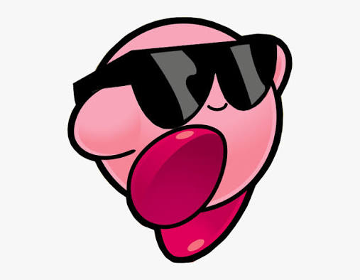
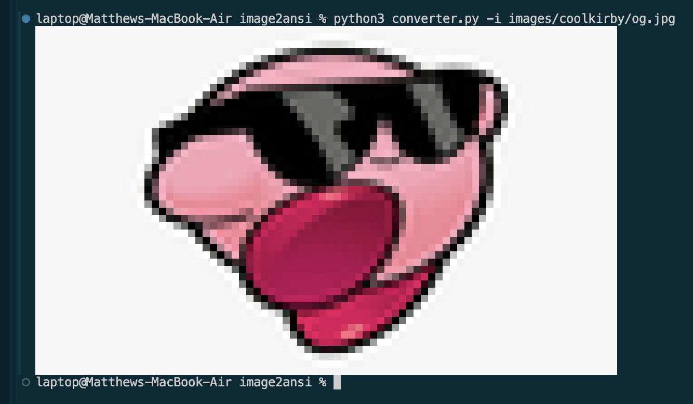
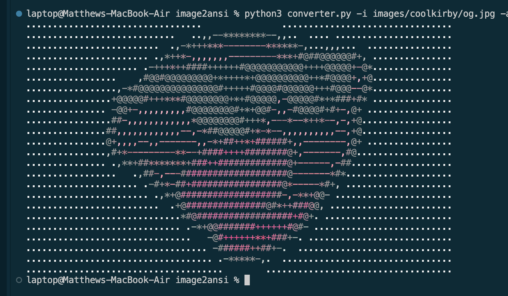
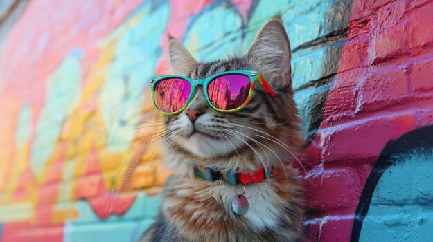
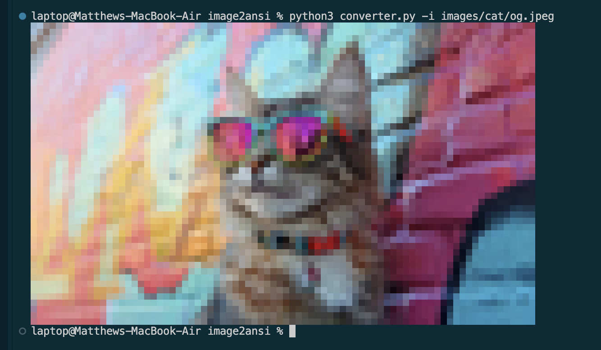
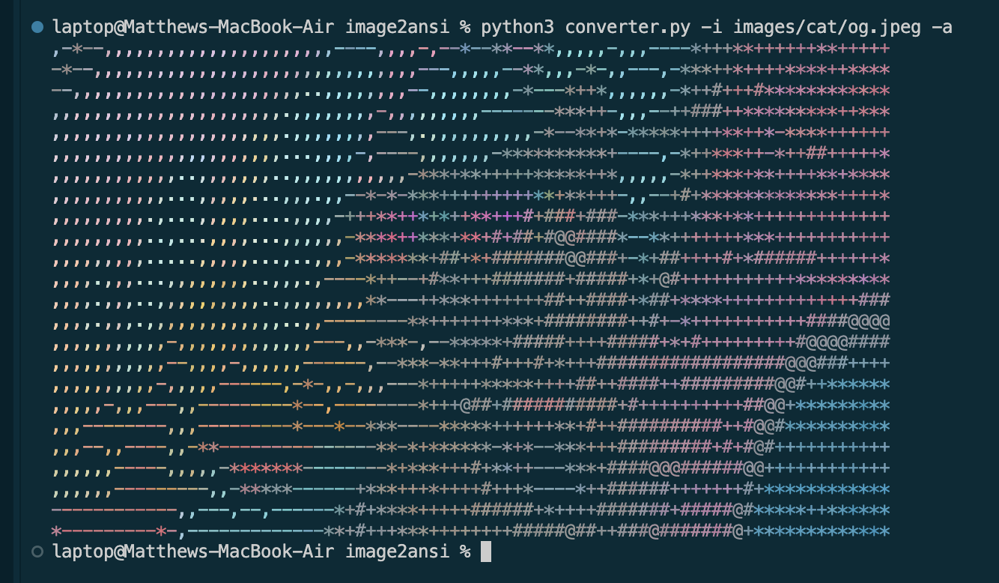

# ImageToANSI

A simple image-to-ANSI + ASCII art converter, written in Python.

## Program arguments.

| Argument | Description |
|---|---|
| `-i`, `--image` | Path to the image you want to convert. Required. |
| `-w`, `--width` | Sets the output width in characters. Defaults to `80`. |
| `-he`, `--height` | Sets the output height in characters. Defaults to `24`. |
| `-a`, `--ascii` | Enables ASCII rendering instead of ANSI rendering. |

# Example outputs.

### Cool Kirby

#### Original

#### ANSI

#### ASCII

### Rainbow Cat

#### Original

#### ANSI

#### ASCII

